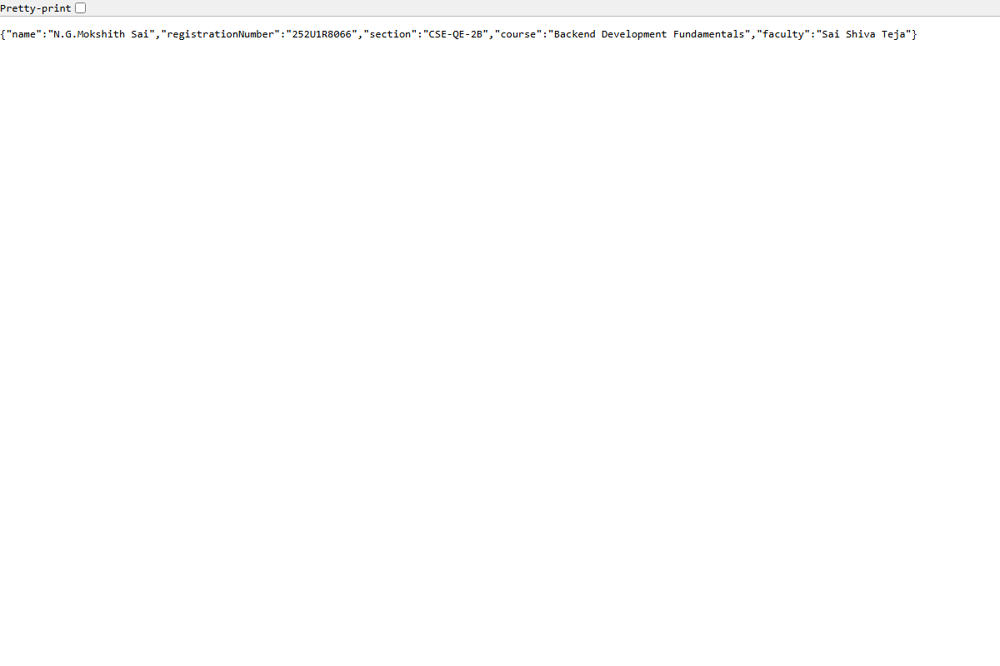
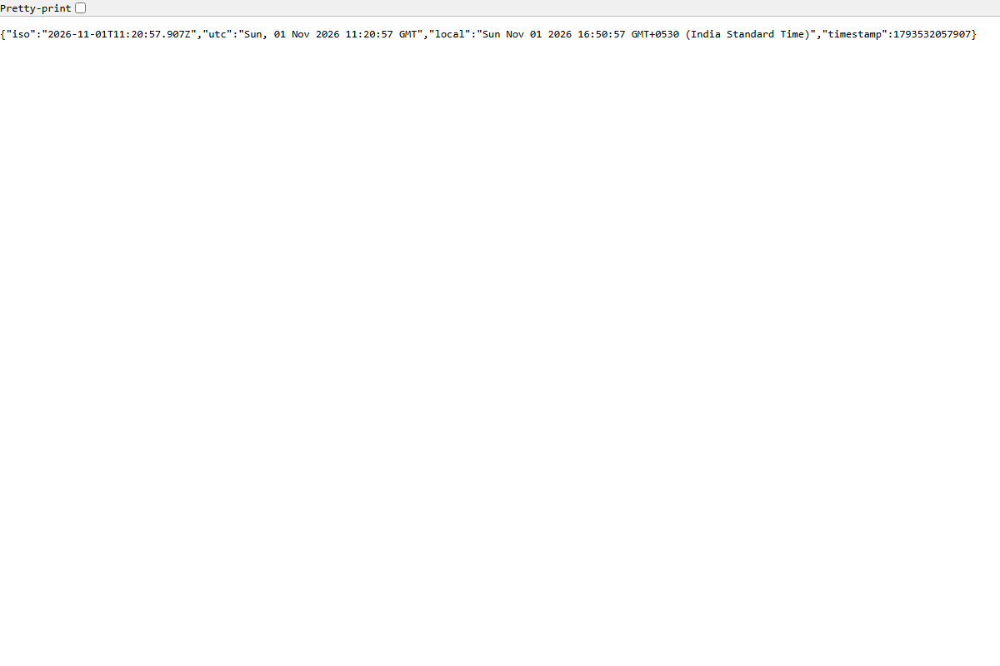
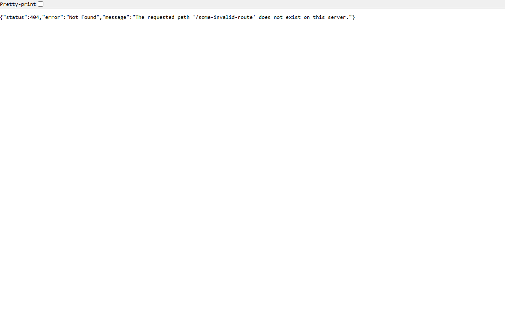

# Lab 1: Node.js and Express server

**N.G.Mokshith Sai** · **252U1R8066** · **CSE-QE-2B**  
**Course:** Backend Development Fundamentals (Year II · Term II)  
**Institution:** Aurora  
**Faculty:** Sai Shiva Teja  
**GitHub Repository:** [https://github.com/mokshithsai1/BACKEND_DEVOLPMENT_LAB_REPORT_MOKSHITH_SAI-](https://github.com/mokshithsai1/BACKEND_DEVOLPMENT_LAB_REPORT_MOKSHITH_SAI-)  

---

## 🌐 Live Deployment Link

- **Live URL:** [https://lab-01-express-server.onrender.com](https://lab-01-express-server.onrender.com) *(or configure your deployed URL on Render / Railway / NxtWave Cloud IDE)*
- **Alternative / Local Status:** If the public cloud deployment is pending or inactive, the full application can be run locally following the steps below. Complete end-to-end screenshots of all browser and HTTP responses with their corresponding status codes are provided in the [Screenshots](#screenshots) section.

---

## 🛠️ How to Run

### Prerequisites
- **Node.js** (v18.0.0 or higher recommended, tested on Node v24.15.0)
- **npm** (v9.0.0 or higher, tested on npm 11.12.1)

### 1. Installation
Navigate into the `lab-01` directory and install the project dependencies:
```bash
cd lab-01
npm install
```

### 2. Environment Variables
You can configure the server using environment variables (optional). Create a `.env` file in the `lab-01` directory if you wish to override defaults:

```env
# Server Port
PORT=3000

# Student Details
STUDENT_NAME=N.G.Mokshith Sai
STUDENT_REG_NO=252U1R8066
STUDENT_SECTION=CSE-QE-2B
FACULTY_NAME=Sai Shiva Teja
```
> **Security Rule:** Never commit real secrets or `.env` files to Git. The `.gitignore` file is configured to exclude all `.env` files.

### 3. Execution Commands

#### Run the Express Server (Tasks 4–7)
```bash
npm start
```
*Or run directly with Node:*
```bash
node server.js
```

#### Run in Development Mode (Auto-restart on change)
```bash
npm run dev
```

#### Run the Plain Node.js HTTP Server (Task 3)
```bash
npm run start:http
```
*Or:*
```bash
node http-server.js
```

---

## 📋 Endpoints Table

| Method | Endpoint | Description | Status Code | Content-Type |
| :--- | :--- | :--- | :---: | :--- |
| `GET` | `/` | Returns welcome message as plain text | `200 OK` | `text/plain` |
| `GET` | `/about` | Returns student details (name, reg. no., section, course, faculty) in JSON format | `200 OK` | `application/json` |
| `GET` | `/time` | Returns the current server date and time using `new Date()` in ISO, UTC, and local formats | `200 OK` | `application/json` |
| `GET` | `/*` (any unknown path) | Catch-all 404 handler returning structured error message in JSON | `404 Not Found` | `application/json` |

---

## 📸 Screenshots

All screenshots are stored in the [`screenshots/`](screenshots/) directory and demonstrate verified execution of both servers and all required endpoints.

### 1. Plain Node.js HTTP Server (`http.createServer`) — Task 3
Replies with `"Hello"` on port 3000.


### 2. Express Server Root Route (`GET /`) — Task 5.1
Returns welcome text with HTTP status code `200 OK`.


### 3. Student Information Route (`GET /about`) — Task 5.2
Returns student name, registration number, section, course, and faculty in JSON format with status code `200 OK`.


### 4. Current Time Route (`GET /time`) — Task 5.3
Generates and returns dynamic timestamp and formatted date using `new Date()` with status code `200 OK`.


### 5. Unknown Route 404 Handler (`GET /<unknown>`) — Task 6
Handles any non-existent endpoint, returning a 404 status code and error message in JSON.


---

## 📝 Explanation of `package.json` Fields (Task 1)

When initializing the Node.js project using `npm init -y`, npm generates a standard `package.json` manifest file. The fields serve the following purposes:

| Field | Purpose |
| :--- | :--- |
| `"name"` | The unique identifier and name of the package/project (e.g., `"lab-01"`). Must be lowercase, URL-friendly, and one word or hyphenated. |
| `"version"` | The current semantic version (`MAJOR.MINOR.PATCH`) of the project following semver standards (e.g., `"1.0.0"`). |
| `"description"` | A concise summary explaining the project's purpose and functionality. Helpful for package documentation and discovery. |
| `"main"` | The primary entry point file of the application that gets executed when the package is required or started (e.g., `"server.js"`). |
| `"scripts"` | A dictionary of custom CLI shortcuts and lifecycle commands executed via `npm run <script-name>` (e.g., `"start": "node server.js"`). |
| `"keywords"` | An array of search terms and categories that describe the application or library. |
| `"author"` | The creator or maintainer of the project (`"N.G.Mokshith Sai"`). Can include name, email, and URL. |
| `"license"` | The software license under which the codebase is distributed (e.g., `"ISC"` or `"MIT"`), declaring open-source permissions. |
| `"dependencies"` | Production dependencies required at runtime (e.g., `"express": "^4.21.2"`). Managed automatically by npm. |

---

## 📂 Locating Express in `node_modules` (Task 2)

Running `npm install express` performs the following actions:
1. Resolves and downloads `express` and its transitive dependencies from the npm registry.
2. Places the library files inside the local directory:
   ```
   lab-01/node_modules/express/
   ```
3. Inside `node_modules/express/`:
   - `index.js`: The entry point that exports the Express application factory function.
   - `lib/`: The core Express codebase containing routers, middleware, request/response prototypes, and application helpers.
   - `package.json`: Metadata specific to Express itself, defining its version, exports, and sub-dependencies.
4. Generates or updates `package-lock.json`, pinning the exact versions and integrity hashes of every installed dependency.

---

## 💬 Viva Questions & Answers

### Q1: What is the difference between `package.json` and `node_modules`?
- **`package.json`**:
  - A lightweight manifest file tracked in Git version control.
  - Documents project metadata, execution scripts, and declared dependencies (with semantic version ranges).
  - Specifies *what* libraries the project needs, but does not contain the actual library code.
- **`node_modules`**:
  - The local directory containing the actual downloaded source code and binaries of all installed packages and their sub-dependencies.
  - Very large in file size and machine-dependent.
  - **Never committed to version control** (ignored via `.gitignore`). Any developer or deployment server can recreate `node_modules` at any time by running `npm install`.

### Q2: What does `app.listen()` do?
- In Express, `app.listen(PORT, [callback])` binds the HTTP server to a specified network port (such as 3000) and starts listening for incoming TCP connections.
- Under the hood, it creates a native Node.js HTTP server instance (`http.createServer(app)`) and invokes `server.listen()`.
- The optional callback function runs once the server has successfully bound to the port, typically used to log the server URL and readiness status.

### Q3: What do `request` (`req`) and `response` (`res`) represent?
- **`request` (`req`)**:
  - An object representing the incoming HTTP request sent by the client (browser, Postman, curl).
  - Contains request details such as HTTP method (`req.method`), URL/path (`req.url`, `req.originalUrl`), route parameters (`req.params`), query strings (`req.query`), headers (`req.headers`), and request body (`req.body`).
- **`response` (`res`)**:
  - An object representing the outgoing HTTP response that the Express server sends back to the client.
  - Provides helper methods to format and transmit the response, such as `res.status(code)` to set the HTTP status code, `res.send()` for text/HTML, `res.json()` for structured JSON payloads, and `res.setHeader()` for response headers.

---

## 💡 Notes: Problems Faced and How They Were Solved

1. **Port Conflicts**:
   - *Problem:* When running the plain HTTP server and Express server back-to-back, attempting to bind both to port 3000 simultaneously causes an `EADDRINUSE` error.
   - *Solution:* Gracefully shut down the first process before starting the next, and parameterized the port using `process.env.PORT || 3000` to support dynamic host configurations.

2. **Status Code Logging (Task 7)**:
   - *Problem:* Standard middleware executing with `next()` runs *before* route handlers set their final response status code.
   - *Solution:* Attached a listener to the `res.on('finish')` event inside a custom logging middleware. This guarantees that the log records the exact final status code (e.g., 200, 404) and response latency after the route handler has completed execution.

3. **Catch-all 404 Route Placement**:
   - *Problem:* If the 404 handler is registered before specific route definitions, it intercepts all requests prematurely.
   - *Solution:* Positioned the 404 middleware at the very end of the middleware chain, ensuring it only executes when no matching route handler responds.
