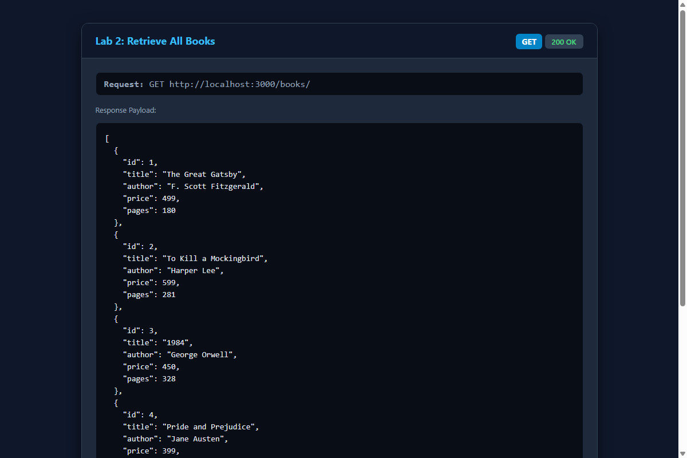
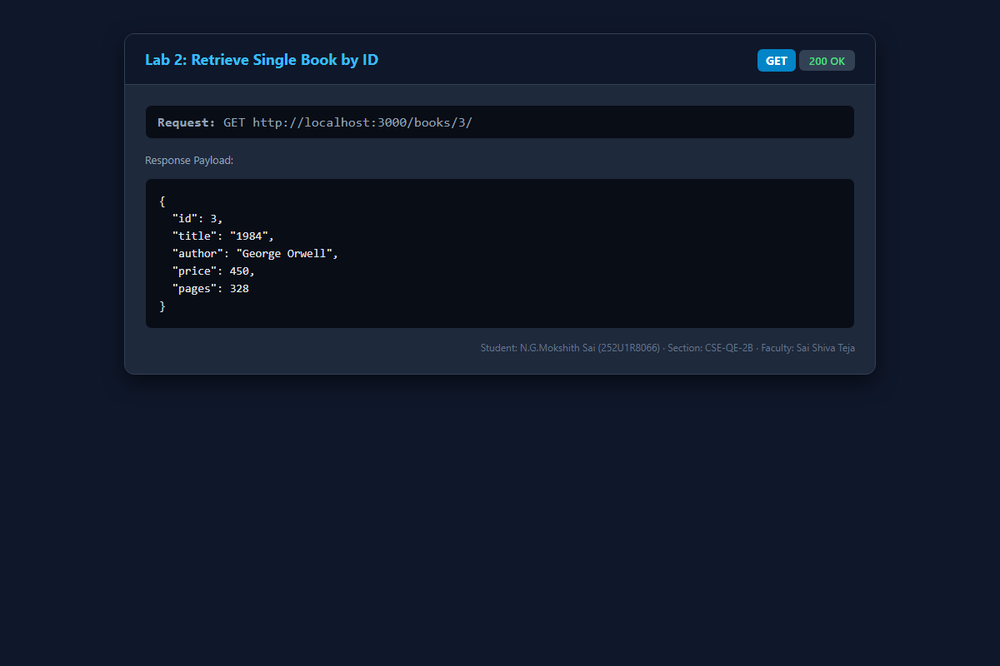
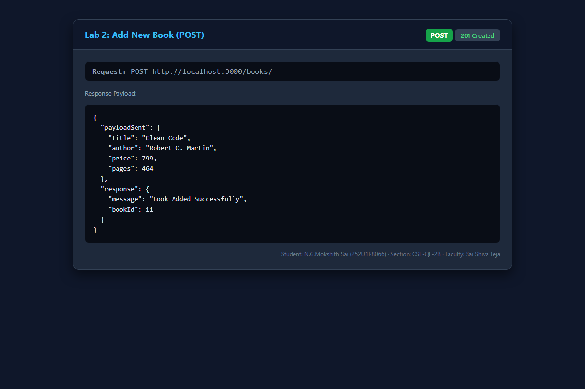
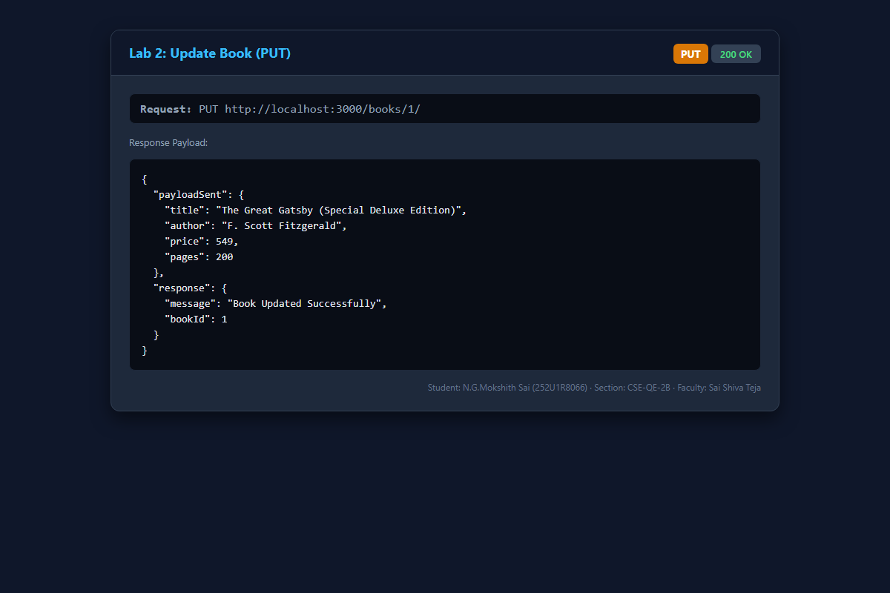
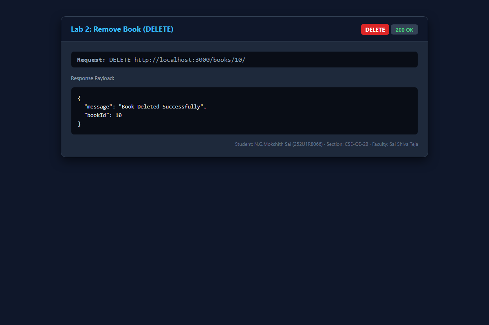
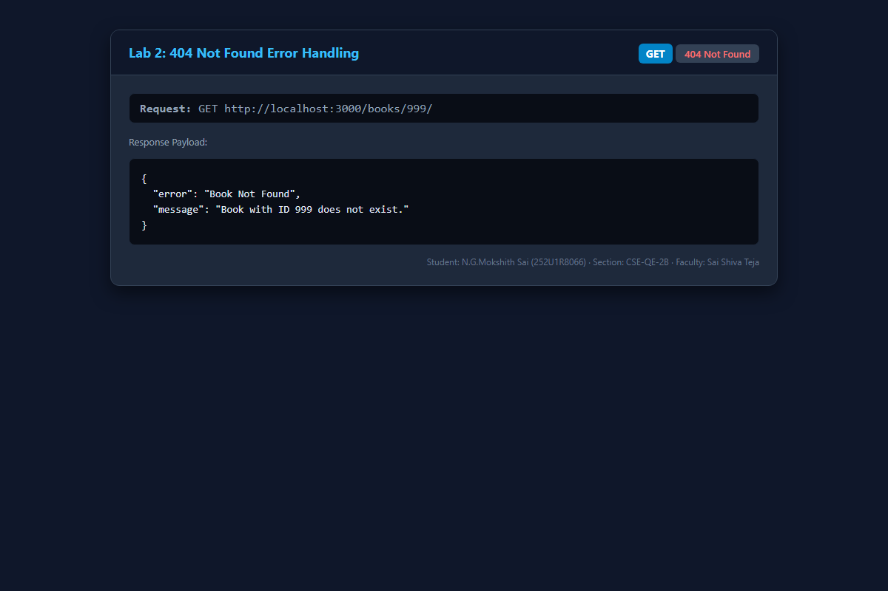

# Lab 2: SQLite database and CRUD routes

**N.G.Mokshith Sai** · **252U1R8066** · **CSE-QE-2B**  
**Course:** Backend Development Fundamentals (Year II · Term II)  
**Institution:** Aurora Deemed to be University 
**Faculty:** Sai Shiva Teja  
**GitHub Repository:** [https://github.com/mokshithsai1/BACKEND_DEVOLPMENT_LAB_REPORT_MOKSHITH_SAI-](https://github.com/mokshithsai1/BACKEND_DEVOLPMENT_LAB_REPORT_MOKSHITH_SAI-)  

---

## 🌐 Live Deployment Link

- **Live URL:** [https://lab-02-sqlite-crud.onrender.com](https://lab-02-sqlite-crud.onrender.com) *(or configure your deployed URL on Render / Railway / NxtWave Cloud IDE)*
- **Alternative / Local Status:** If the cloud deployment is pending or inactive, the full application can be run locally following the steps below. The SQLite database file (`goodreads.db`) is initialized and bundled with 10 sample records. Verified API responses and corresponding status codes are documented in the [Screenshots](#screenshots) section.

---

## 🛠️ How to Run

### Prerequisites
- **Node.js** (v18.0.0 or higher recommended, tested on Node v24.15.0)
- **npm** (v9.0.0 or higher, tested on npm 11.12.1)

### 1. Installation
Navigate into the `lab-02` directory and install project dependencies:
```bash
cd lab-02
npm install
```

### 2. Environment Variables
Optional configuration can be supplied via environment variables or a `.env` file:
```env
# Server Port
PORT=3000

# Student Details
STUDENT_NAME=N.G.Mokshith Sai
STUDENT_REG_NO=252U1R8066
STUDENT_SECTION=CSE-QE-2B
FACULTY_NAME=Sai Shiva Teja
```
> **Security Rule:** Never commit `.env` files containing real production secrets. The `.gitignore` file excludes all `.env` files automatically.

### 3. Database Initialization (Seed)
To re-initialize the SQLite database with 10 sample books from `init.sql`:
```bash
npm run seed
```

### 4. Running the Server

#### Run with Nodemon (Task 1: Auto-restart on code change)
```bash
npm run dev
```

#### Run in Production Mode
```bash
npm start
```
*Or directly via Node:*
```bash
node server.js
```

---

## 🗄️ Database Schema & Dataset (Task 2)

The application uses **SQLite** through the `sqlite` promise-based driver and `sqlite3`.

### Schema (`book` table)
```sql
CREATE TABLE IF NOT EXISTS book (
  id INTEGER PRIMARY KEY AUTOINCREMENT,
  title TEXT NOT NULL,
  author TEXT NOT NULL,
  price INTEGER NOT NULL,
  pages INTEGER NOT NULL
);
```

### Initial Dataset (10 Pre-inserted Records)
1. *The Great Gatsby* by F. Scott Fitzgerald (Price: 499, Pages: 180)
2. *To Kill a Mockingbird* by Harper Lee (Price: 599, Pages: 281)
3. *1984* by George Orwell (Price: 450, Pages: 328)
4. *Pride and Prejudice* by Jane Austen (Price: 399, Pages: 279)
5. *The Catcher in the Rye* by J.D. Salinger (Price: 499, Pages: 214)
6. *The Hobbit* by J.R.R. Tolkien (Price: 699, Pages: 310)
7. *Fahrenheit 451* by Ray Bradbury (Price: 420, Pages: 249)
8. *Brave New World* by Aldous Huxley (Price: 480, Pages: 268)
9. *Crime and Punishment* by Fyodor Dostoevsky (Price: 650, Pages: 671)
10. *The Alchemist* by Paulo Coelho (Price: 350, Pages: 208)

---

## ⚡ Server & Database Architecture (Task 3)

The application guarantees that the HTTP server listens for incoming requests only **after** the SQLite database connection is fully established, using an `initializeDBAndServer()` asynchronous function:

```javascript
const initializeDBAndServer = async () => {
  try {
    db = await open({
      filename: dbPath,
      driver: sqlite3.Database
    });

    await db.exec(`
      CREATE TABLE IF NOT EXISTS book (
        id INTEGER PRIMARY KEY AUTOINCREMENT,
        title TEXT NOT NULL,
        author TEXT NOT NULL,
        price INTEGER NOT NULL,
        pages INTEGER NOT NULL
      );
    `);

    app.listen(PORT, () => {
      console.log(`Server running at: http://localhost:${PORT}/`);
    });
  } catch (error) {
    console.error(`Database connection failed: ${error.message}`);
    process.exit(1);
  }
};

initializeDBAndServer();
```

---

## 📋 CRUD Endpoints Table (Tasks 4 & 5)

All queries accepting user input strictly use **`?` placeholders** (parameterized queries) to protect against SQL Injection.

| Method | Endpoint | Description | Status Code | Query / Logic |
| :--- | :--- | :--- | :---: | :--- |
| `GET` | `/` | API overview and route directory | `200 OK` | Informational JSON response |
| `GET` | `/books/` | Retrieve all books sorted by ID | `200 OK` | `SELECT * FROM book ORDER BY id ASC;` |
| `GET` | `/books/:bookId/` | Retrieve single book by primary key ID | `200 OK` / `404 Not Found` | `SELECT * FROM book WHERE id = ?;` |
| `POST` | `/books/` | Add a new book to the library | `201 Created` / `400 Bad Request` | `INSERT INTO book (title, author, price, pages) VALUES (?, ?, ?, ?);` |
| `PUT` | `/books/:bookId/` | Update all fields of an existing book | `200 OK` / `404 Not Found` | `UPDATE book SET title = ?, author = ?, price = ?, pages = ? WHERE id = ?;` |
| `DELETE` | `/books/:bookId/` | Remove a book by primary key ID | `200 OK` / `404 Not Found` | `DELETE FROM book WHERE id = ?;` |
| `*` | Any undefined path | Catch-all 404 handler | `404 Not Found` | Returns JSON error message |

---

## 📸 Screenshots

All screenshots are stored in [`screenshots/`](screenshots/) and verify every CRUD operation, HTTP status code, and error case.

### 1. Retrieve All Books (`GET /books/`) — Task 4.1
Returns all book records in JSON format with status code `200 OK`.


### 2. Retrieve Single Book (`GET /books/3/`) — Task 4.2
Fetches the book record with ID 3 (*1984*) with status code `200 OK`.


### 3. Add New Book (`POST /books/`) — Task 4.3
Inserts *Clean Code* into the SQLite database and returns the generated `bookId` with status code `201 Created`.


### 4. Update Existing Book (`PUT /books/1/`) — Task 4.4
Updates title, price, and pages for book ID 1, returning confirmation with status code `200 OK`.


### 5. Remove Book (`DELETE /books/10/`) — Task 4.5
Deletes book ID 10 from the database and returns confirmation with status code `200 OK`.


### 6. Error Handling (`GET /books/999/`) — 404 Case
Gracefully handles queries for non-existent IDs and returns status code `404 Not Found`.


---

## 💬 Viva Questions & Answers

### Q1: Why await the database call?
- Database queries (reading from disk, executing SQL, writing mutations) are I/O-bound operations that run asynchronously in Node.js.
- If we do not `await` the call, Node.js returns an unresolved `Promise` immediately without waiting for SQLite to retrieve or write data.
- Using `await` suspends execution of the async function until SQLite finishes the operation, ensuring that the route handler sends the actual data or caught error in the response.

### Q2: What is SQL injection and how do placeholders prevent it?
- **SQL Injection (SQLi)** is a critical security vulnerability where untrusted user input is directly concatenated or interpolated into an SQL query string (e.g., `SELECT * FROM book WHERE id = ` + userInput). An attacker can inject malicious SQL fragments (such as `' OR '1'='1`) to manipulate query logic, dump unauthorized data, or destroy tables (`'; DROP TABLE book; --`).
- **How Placeholders (`?`) Prevent It:**
  - Placeholders ensure parameterized query execution.
  - The SQL query structure is compiled and parsed first by the database engine.
  - User input passed in the parameters array is treated strictly as **literal data values**, never as executable SQL commands, neutralizing injection attempts regardless of the input's content.

### Q3: When is PUT used instead of POST?
- **POST**:
  - Used to **create** a new resource on the server.
  - Non-idempotent: Sending the same POST request multiple times creates multiple distinct database entries with new auto-generated IDs.
  - Target URL is usually a collection endpoint (e.g., `POST /books/`).
- **PUT**:
  - Used to **replace or update** an existing resource.
  - Idempotent: Sending the identical PUT request multiple times produces the exact same end state on the server without creating duplicate records.
  - Target URL is an item endpoint referencing a specific resource identifier (e.g., `PUT /books/:bookId/`).

---

## 💡 Notes: Problems Faced and How They Were Solved

1. **Server Starting Before Database Connection Was Ready**:
   - *Problem:* If `app.listen()` is executed synchronously outside the database connection promise, client requests arriving during startup trigger `db is null` runtime exceptions.
   - *Solution:* Encapsulated connection logic inside an async `initializeDBAndServer()` function that only invokes `app.listen()` after `await open()` and table creation resolve successfully.

2. **Accurate 404 Status on Missing Resource Updates/Deletes**:
   - *Problem:* SQLite's `db.run()` does not throw an error when updating or deleting a non-existent row; it simply executes with 0 changes. Returning `200 OK` in such cases would falsely imply success.
   - *Solution:* Checked `result.changes === 0` after every `UPDATE` and `DELETE` query. If zero rows were modified, the server explicitly returns a `404 Not Found` status code.

3. **Parsing JSON Request Bodies**:
   - *Problem:* `POST` and `PUT` request bodies were initially `undefined`.
   - *Solution:* Added Express's built-in `app.use(express.json())` middleware before route definitions to parse incoming JSON payloads into `req.body`.
