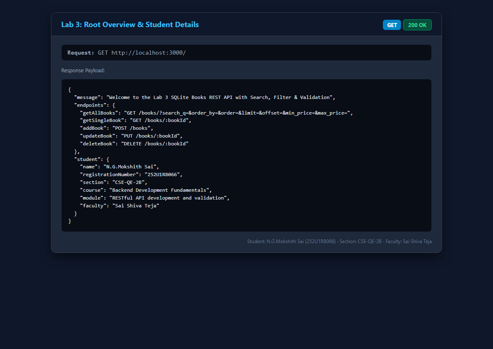
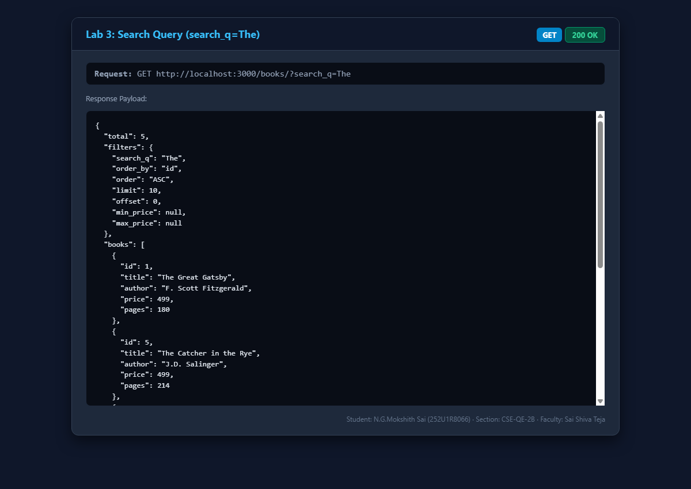
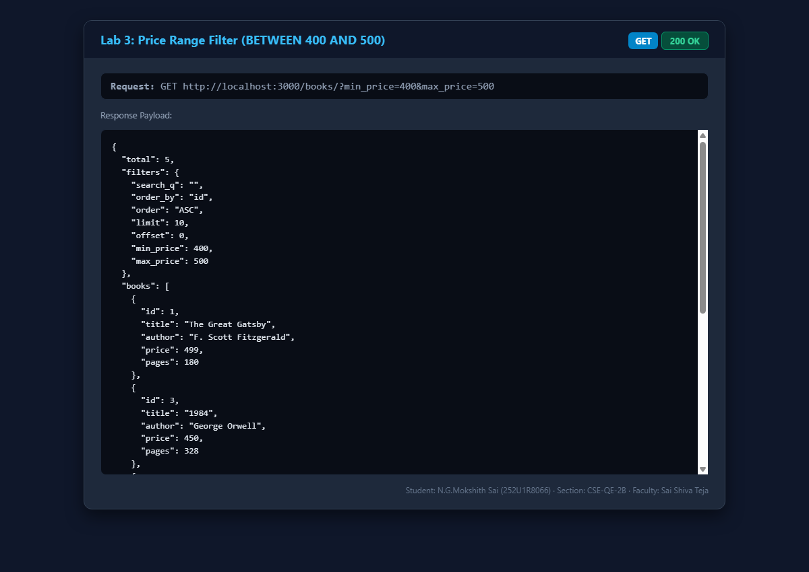
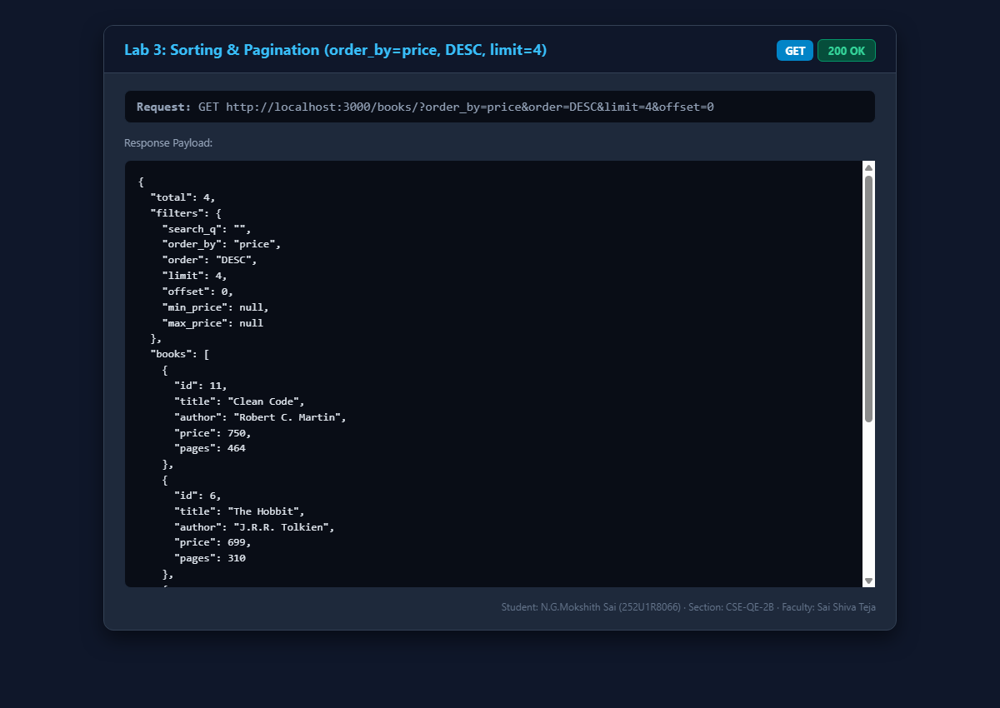
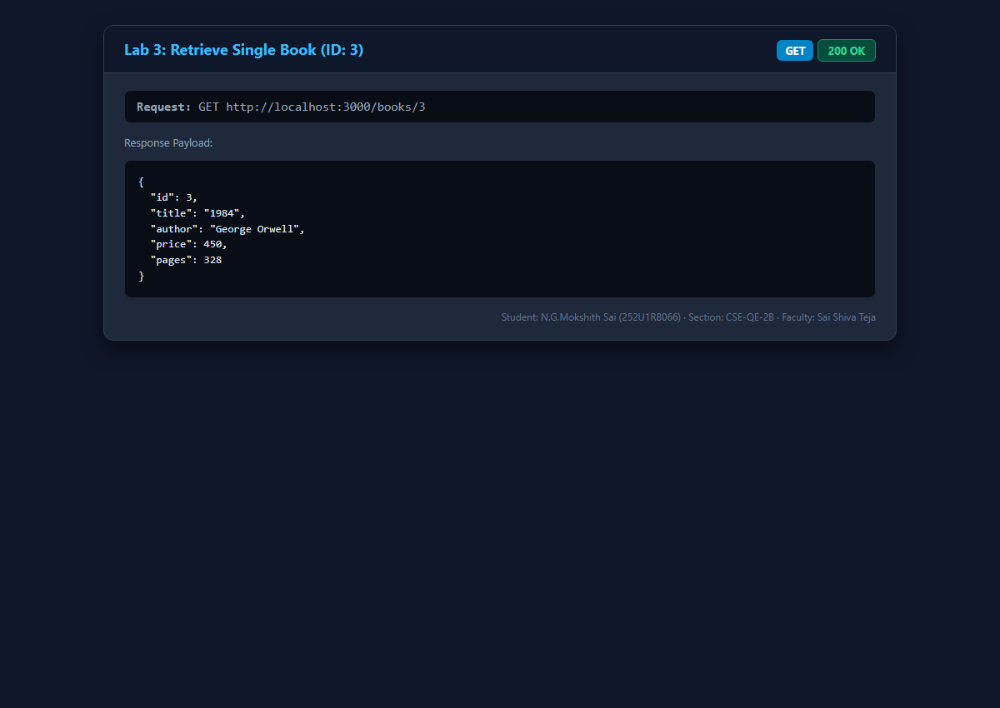
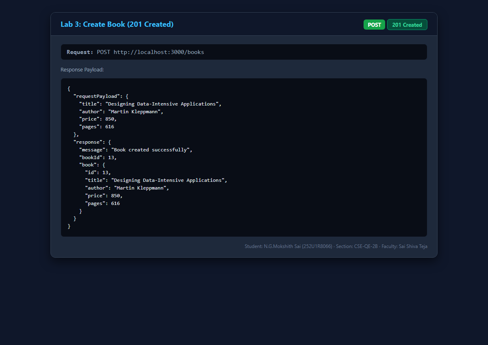
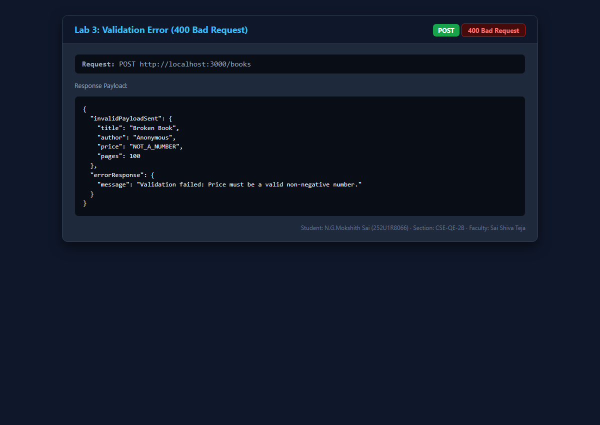
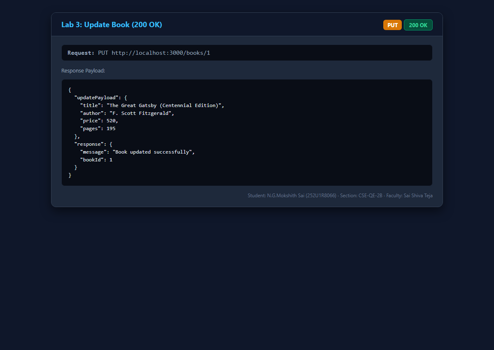
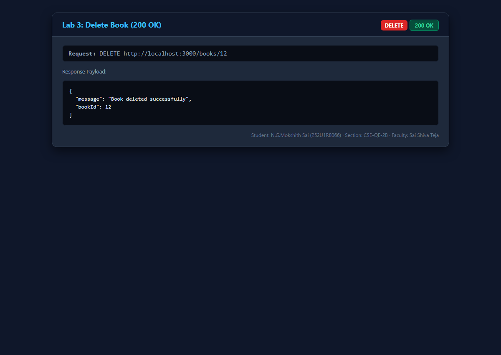
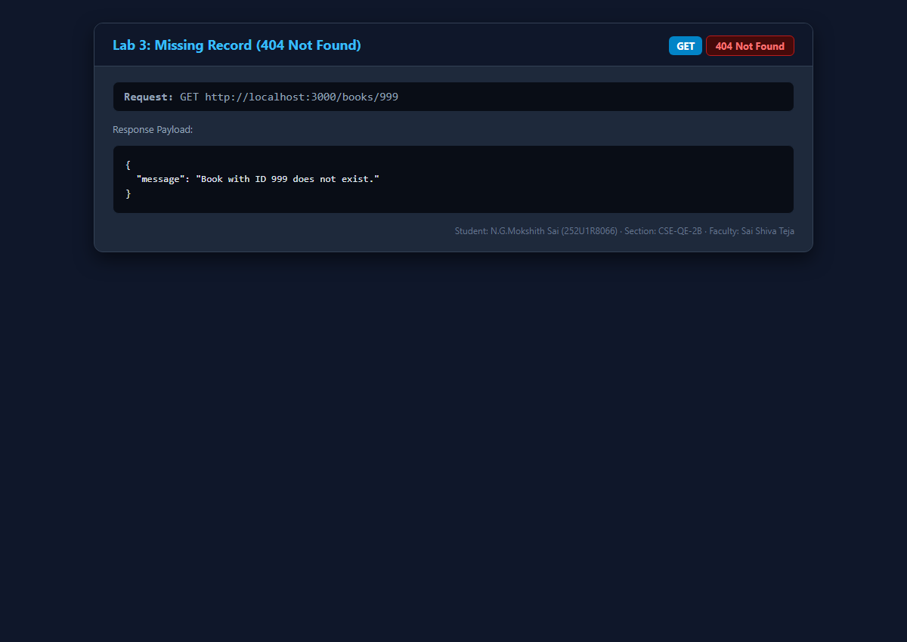

# Lab 3: REST API, query parameters, validation, debugging

**N.G.Mokshith Sai** · **252U1R8066** · **CSE-QE-2B**  
**Course:** Backend Development Fundamentals (Year II · Term II)  
**Institution:** Aurora  
**Faculty:** Sai Shiva Teja  
**GitHub Repository:** [https://github.com/mokshithsai1/BACKEND_DEVOLPMENT_LAB_REPORT_MOKSHITH_SAI-](https://github.com/mokshithsai1/BACKEND_DEVOLPMENT_LAB_REPORT_MOKSHITH_SAI-)  

---

## 🌐 Live Deployment Link

- **Live URL:** [https://bdf-lab-03-mokshith-sai.onrender.com](https://bdf-lab-03-mokshith-sai.onrender.com) *(or configure your deployed URL on Render / Railway / NxtWave Cloud IDE)*
- **Alternative / Local Status:** If the public cloud deployment is pending or during evaluation, the full REST API can be executed locally following the steps below. The SQLite database file (`goodreads.db`) is included and pre-seeded with 12 records. Complete end-to-end screenshots demonstrating query parameter filters, input validation, and HTTP status codes are provided in the [Screenshots](#screenshots) section.

---

## 🛠️ How to Run

### Prerequisites
- **Node.js** (v18.0.0 or higher recommended, tested on Node v24.15.0)
- **npm** (v9.0.0 or higher, tested on npm 11.12.1)

### 1. Installation
Navigate into the `lab-03` directory and install project dependencies:
```bash
cd lab-03
npm install
```

### 2. Environment Variables
Optional configuration can be supplied via environment variables or a local `.env` file:
```env
# Server Port
PORT=3000

# Student Details
STUDENT_NAME=N.G.Mokshith Sai
STUDENT_REG_NO=252U1R8066
STUDENT_SECTION=CSE-QE-2B
FACULTY_NAME=Sai Shiva Teja
```
> **Security Rule:** Never commit `.env` files containing sensitive credentials. The `.gitignore` file excludes all `.env` files automatically.

### 3. Database Initialization (Seed)
To re-initialize the SQLite database with 12 sample books from `init.sql`:
```bash
npm run seed
```

### 4. Running the Server

#### Run with Nodemon (Auto-restart on code change)
```bash
npm run dev
```

#### Run in Production Mode
```bash
npm start
```
*Or directly via Node:*
```bash
node server.js
```

---

## 📋 REST API Endpoints & Query Parameters Table

All endpoints are named as nouns (`/books`) following standard REST conventions, using HTTP methods to signal actions. Every query taking user input strictly employs **parameterized queries (`?` placeholders)** to prevent SQL injection.

| Method | Endpoint | Query Parameters | Description | Status Code |
| :--- | :--- | :--- | :--- | :---: |
| `GET` | `/` | None | API root overview & student credentials | `200 OK` |
| `GET` | `/books` | `search_q`, `order_by`, `order`, `limit`, `offset`, `min_price`, `max_price` | List books with search, price filters, sorting, and pagination | `200 OK` |
| `GET` | `/books/:bookId` | None | Retrieve single book by primary key ID | `200 OK` / `404 Not Found` |
| `POST` | `/books` | None | Add a new book with strict payload validation | `201 Created` / `400 Bad Request` |
| `PUT` | `/books/:bookId` | None | Update an existing book with validation | `200 OK` / `400 Bad Request` / `404 Not Found` |
| `DELETE` | `/books/:bookId` | None | Delete a book by primary key ID | `200 OK` / `404 Not Found` |
| `*` | Any undefined path | None | Catch-all 404 handler with consistent JSON message | `404 Not Found` |

### Supported Query Parameters for `GET /books`
1. **`search_q`** (String, default `""`): Partial title match using SQL `title LIKE ?` (e.g. `?search_q=The`).
2. **`min_price` & `max_price`** (Numeric, optional): Price range filtering using `price BETWEEN ? AND ?` or inequality conditions (e.g. `?min_price=400&max_price=500`).
3. **`order_by`** (String, default `'id'`): Column to sort by (`id`, `title`, `author`, `price`, `pages`). Validated against an allowed whitelist.
4. **`order`** (String, default `'ASC'`): Sorting direction (`ASC` or `DESC`).
5. **`limit`** (Integer, default `10`): Maximum number of records to return per page.
6. **`offset`** (Integer, default `0`): Number of records to skip for pagination.

---

## 🛡️ Request Validation Rules (Task 4)

Incoming `POST` and `PUT` request bodies are strictly validated before running SQL queries:
- **`title`**: Must be a non-empty string. If missing or blank, returns `400 Bad Request` with `{"message": "Validation failed: Title is required and cannot be empty."}`.
- **`author`**: Must be a non-empty string. If missing or blank, returns `400 Bad Request` with `{"message": "Validation failed: Author is required and cannot be empty."}`.
- **`price`**: Must be a non-negative number. Non-numeric or negative values return `400 Bad Request` with `{"message": "Validation failed: Price must be a valid non-negative number."}`.
- **`pages`**: Must be a positive integer. Invalid values return `400 Bad Request` with `{"message": "Validation failed: Pages must be a positive integer."}`.
- **Consistent Response Format (Task 6)**: All errors return a unified JSON structure: `{ "message": "..." }`.

---

## 📸 Screenshots

All screenshots are stored in [`screenshots/`](screenshots/) and verify every query parameter filter, CRUD operation, validation failure, and status code.

### 1. Root Overview & Student Credentials (`GET /`)
Returns welcome message, endpoint dictionary, and student credentials.


### 2. Search Filter with LIKE (`GET /books/?search_q=The`) — Task 2
Filters books whose title contains the substring "The" using `title LIKE ?`.


### 3. Price Range Filter (`GET /books/?min_price=400&max_price=500`) — Task 3
Filters books with prices between 400 and 500 using `price BETWEEN ? AND ?`.


### 4. Sorting & Pagination (`GET /books/?order_by=price&order=DESC&limit=4&offset=0`) — Task 2
Sorts books by price descending with limit 4 and offset 0.


### 5. Retrieve Single Book (`GET /books/3`)
Fetches book with ID 3 (*1984*) with status code `200 OK`.


### 6. Create Book with Validation (`POST /books`) — Task 5 (201 Created)
Inserts *Designing Data-Intensive Applications* and returns `201 Created`.


### 7. Validation Failure Handling (`POST /books`) — Task 4 (400 Bad Request)
Rejects invalid non-numeric price (`"NOT_A_NUMBER"`) with status `400 Bad Request`.


### 8. Update Existing Book (`PUT /books/1`) — Task 5 (200 OK)
Updates title, price, and pages for book ID 1, returning confirmation with status `200 OK`.


### 9. Delete Book (`DELETE /books/12`) — Task 5 (200 OK)
Deletes book ID 12 from the database and returns confirmation with status `200 OK`.


### 10. Missing Record Error (`GET /books/999`) — Task 5 (404 Not Found)
Handles non-existent IDs gracefully, returning status `404 Not Found`.


---

## 🔍 Debugging Exercise (Common Backend Pitfalls & Fixes)

As part of the Lab 3 debugging exercise, students investigated and fixed four common backend errors:

### 1. Port Conflict (`EADDRINUSE: address already in use :::3000`)
- **Symptom:** Server crashes immediately on startup with `Error: listen EADDRINUSE: address already in use :::3000`.
- **Root Cause:** Another process (e.g. an earlier server instance or background task) is already listening on port 3000.
- **Fix:** Terminate the lingering process using task manager or shell commands (`npx kill-port 3000` or `Stop-Process`), or make the port dynamic: `const PORT = process.env.PORT || 3000;`.

### 2. Wrong Import Path (`Cannot find module './database'`)
- **Symptom:** `Error: Cannot find module '../db' or './database'`.
- **Root Cause:** Incorrect relative path syntax, typo in filename, or missing file extension when using CommonJS `require()`.
- **Fix:** Use `path.join(__dirname, 'relative/path')` or verify exact relative directory structure (e.g. `require('./goodreads.db')` vs `path.join(__dirname, 'goodreads.db')`).

### 3. Table-Name Typo (`SQLITE_ERROR: no such table: books`)
- **Symptom:** `SQLITE_ERROR: no such table: books` when executing queries.
- **Root Cause:** Query referenced the plural `books`, but the database schema defined the singular table name `book`.
- **Fix:** Align the SQL query table name with the DDL schema in `init.sql`: change `SELECT * FROM books` to `SELECT * FROM book`.

### 4. Missing `await` in Database Query
- **Symptom:** `res.json(books)` returns an empty object `{}` or a pending `Promise { <pending> }` instead of the database records.
- **Root Cause:** Omitting the `await` keyword before `db.all()`, `db.get()`, or `db.run()`. Because SQLite methods return Promises, the code immediately proceeds without waiting for disk I/O.
- **Fix:** Ensure all database calls are explicitly awaited: `const books = await db.all(query, params);` inside an `async` route handler.

---

## 💬 Viva Questions & Answers

### Q1: Query parameter vs Path parameter?
- **Path Parameter (`/books/:bookId`)**:
  - Embedded directly into the URL path hierarchy.
  - Used to identify a **specific resource** uniquely (e.g. `/books/5` targets the single book with ID 5).
  - Accessed in Express via `req.params.bookId`.
- **Query Parameter (`/books?search_q=The&order_by=price`)**:
  - Appended after the `?` delimiter in key-value pairs separated by `&`.
  - Used for **filtering, searching, sorting, and paginating** a collection without altering the resource identity.
  - Accessed in Express via `req.query.search_q`.

### Q2: What does "stateless" mean in REST?
- Statelessness means that the server does **not store any client session state** between requests.
- Every HTTP request from the client must contain **all the context, parameters, and authentication data** necessary for the server to understand and process that request independently.
- **Benefits:** Improves scalability (any server instance can handle any request), enhances reliability, and simplifies caching.

### Q3: Which status code for bad input vs a missing record?
- **Bad Input → `400 Bad Request`**:
  - The client sent malformed data, omitted required fields, or passed invalid data types (e.g. a string `"free"` for a numeric price). The request cannot be processed due to a client-side syntax or validation error.
- **Missing Record → `404 Not Found`**:
  - The request syntax is valid, but the target resource identifier does not exist on the server (e.g. querying `/books/999` when ID 999 is absent from the database).

---

## 💡 Notes: Problems Faced and How They Were Solved

1. **SQL Injection Vulnerability in Dynamic Sorting**:
   - *Problem:* Using `?` placeholders in SQL `ORDER BY ? ?` fails in SQLite because SQL placeholders can only represent data literals, not column identifiers or keywords.
   - *Solution:* Implemented strict column whitelisting (`['id', 'title', 'author', 'price', 'pages']`) and order whitelisting (`['ASC', 'DESC']`). If the user passes an unapproved column name, the server safely falls back to `'id'`.

2. **Price Range Query Flexibility**:
   - *Problem:* Users might supply only `min_price`, only `max_price`, or both. Hardcoding `price BETWEEN ? AND ?` causes query errors when only one boundary is specified.
   - *Solution:* Dynamically assembled the `WHERE` clause using an array of conditions: pushing `price BETWEEN ? AND ?` when both exist, `price >= ?` when only minimum is provided, and `price <= ?` when only maximum is provided.

3. **Consistent Error Response Contract**:
   - *Problem:* Different middleware and route handlers were returning mixed error formats (`{ error: ... }` vs `{ message: ... }`).
   - *Solution:* Standardized all error responses across 400, 404, and 500 status codes to follow a uniform contract: `{ "message": "..." }`.
